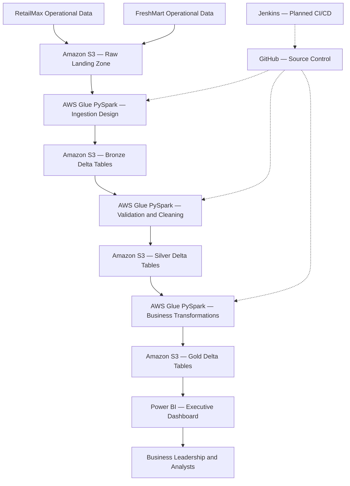
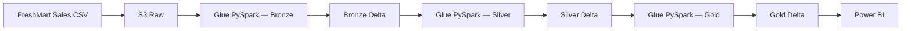

# Enterprise Retail Lakehouse Platform
## Post-Merger Data Consolidation — RetailMax Acquires FreshMart

**Architecture:** AWS Glue | Amazon S3 | PySpark | Delta Lake | Power BI  
**Domain:** Retail Data Engineering and Business Analytics  
**Project:** Enterprise-Style Data Lakehouse Implementation

---

## 1. Executive Summary

RetailMax has acquired FreshMart, bringing together two retail organizations with independent operational systems.

Following the acquisition, leadership needs a consolidated view of sales, customers, products, stores, inventory, and suppliers.

However, combining these datasets introduces challenges such as inconsistent data formats, duplicate records, missing values, and fragmented reporting.

The Enterprise Retail Lakehouse Platform addresses these challenges through an AWS-based data engineering architecture.

The solution is designed around Amazon S3, AWS Glue, PySpark, and Delta Lake, using a Bronze–Silver–Gold Medallion Architecture to transform raw operational data into business-ready datasets.

The resulting Gold-layer datasets are intended to support a unified Power BI dashboard for business stakeholders.

### Business Objectives

- Consolidate RetailMax and FreshMart operational data.
- Establish consistent data quality and transformation rules.
- Create a centralized analytical foundation.
- Support cross-company sales and performance analysis.
- Improve inventory and product visibility.
- Reduce manual data preparation for reporting.
- Build an extensible architecture for future acquisitions.

**Implementation note:** AWS Glue-compatible pipeline components and deployment artifacts have been developed and locally tested. Cloud job creation was blocked by AWS account access restrictions; successful AWS Glue execution is not yet claimed.

---

## 2. Business Problem

### The Post-Merger Challenge

RetailMax and FreshMart previously maintained separate operational data environments.

Their business systems contain similar information, but their data may differ in structure, formatting, identifiers, and quality.

After the merger, leadership needs to answer questions such as:

1. What is the combined revenue of both companies?
2. How does RetailMax performance compare with FreshMart?
3. Which products and categories drive revenue?
4. Which stores perform best?
5. Where are inventory shortages occurring?
6. How can the business produce consistent enterprise-wide reports?

### Business Challenges

| Challenge | Business Impact |
|---|---|
| Fragmented data sources | No unified view of the business |
| Inconsistent formats | Difficult integration |
| Duplicate records | Potentially inaccurate reporting |
| Missing information | Reduced data reliability |
| Separate reporting systems | Slower decision-making |
| Limited traceability | Harder to investigate discrepancies |

The organization needs a centralized data platform that can process both companies' information consistently.

---

## 3. Proposed Solution

The platform uses an AWS Glue-oriented data processing architecture with Amazon S3 as the lakehouse storage foundation.

The processing design follows three layers:

**Bronze:** Ingest and preserve raw operational data.

**Silver:** Clean, validate, standardize, and deduplicate records.

**Gold:** Produce curated analytical datasets for reporting.

AWS Glue is the intended cloud execution environment for the PySpark processing modules.

Delta Lake provides transactional table capabilities across the lakehouse.

Power BI consumes curated analytical outputs to support business reporting.

---

## 4. Enterprise Pipeline Architecture

### Architecture Components

| Component | Responsibility |
|---|---|
| RetailMax and FreshMart | Operational data sources |
| Amazon S3 Raw | Landing zone for incoming datasets |
| AWS Glue | Intended cloud processing and orchestration |
| PySpark | Distributed transformation framework |
| Bronze Delta | Raw data ingestion and traceability |
| Silver Delta | Validated and standardized data |
| Gold Delta | Business-ready analytical datasets |
| Power BI | Reporting and KPI visualization |
| GitHub | Version control |
| Jenkins | Planned build and deployment automation |

---

## 5. Business Data Domains

The lakehouse is designed to integrate six core retail datasets.

| Dataset | Business Significance |
|---|---|
| Customers | Customer base and customer analysis |
| Products | Product and category performance |
| Stores | Store-level operational analysis |
| Sales | Revenue and transaction analysis |
| Inventory | Stock availability and inventory monitoring |
| Suppliers | Supplier and supply-chain analysis |

Each dataset can be processed for both RetailMax and FreshMart.

The consolidated model is intended to preserve company-level distinctions while enabling enterprise-wide analytics.

---

## 6. Bronze Layer — Raw Ingestion

### Purpose

The Bronze layer preserves incoming operational data and provides traceability to the original source.

### Processing Design

1. Receive source CSV files in the Amazon S3 landing zone.
2. Identify the company and dataset.
3. Validate source paths and processing parameters.
4. Determine the batch identifier.
5. Read the source data using PySpark.
6. Prepare the data for Bronze Delta storage.

### Business Value

The Bronze layer helps preserve source context and supports auditing, troubleshooting, and controlled reprocessing.

It separates source ingestion from downstream business transformations.

---

## 7. Silver Layer — Data Quality and Standardization

### Purpose

The Silver layer improves the reliability and consistency of source data.

### Processing Responsibilities

- Validate required fields.
- Handle missing and invalid values.
- Standardize data types.
- Apply transformation rules.
- Identify duplicate records.
- Preserve appropriate source context.
- Produce consistent datasets for downstream analytics.

### Business Example

If RetailMax and FreshMart use different representations for product or transaction attributes, Silver-layer processing can standardize those values before reporting.

### Business Value

The Silver layer creates a more trustworthy foundation for enterprise-wide metrics and reduces inconsistencies between company-level reports.

---

## 8. Gold Layer — Business Analytics

### Purpose

The Gold layer organizes validated data into analytical datasets designed for business reporting.

### Reporting Use Cases

**Sales Analytics**

- Combined company revenue.
- Sales trends over time.
- Revenue comparison by company.
- Product and store performance.

**Product Analytics**

- Product-level performance.
- Category-level trends.
- High-performing and low-performing products.

**Inventory Analytics**

- Stock availability.
- Inventory trends.
- Potential supply constraints.

**Executive Reporting**

- Consolidated KPIs.
- Company comparisons.
- Time-based business analysis.

### Business Value

Gold-layer datasets reduce the need for business users to repeatedly clean and combine operational extracts.

---

## 9. End-to-End Data Flow Example

Consider a sales transaction from FreshMart.

### Step-by-Step Business Interpretation

**Step 1 — Source:** FreshMart generates a sales extract.

**Step 2 — Landing:** The source file is placed in the raw S3 landing zone.

**Step 3 — Bronze:** The ingestion pipeline preserves the source information.

**Step 4 — Silver:** Validation and standardization rules improve the quality of the record.

**Step 5 — Gold:** The clean record contributes to business-level analytical datasets.

**Step 6 — Reporting:** Power BI presents the resulting metrics to business stakeholders.

This describes the target cloud execution flow. The underlying processing components are being validated locally before cloud deployment.

---

## 10. Incremental Processing and Batch Identification

Enterprise data pipelines must handle incoming data predictably and avoid unnecessary reprocessing.

The project includes batch planning and object-identity logic.

### Batch Processing Design

1. Identify the incoming source object.
2. Validate its company, dataset, and path.
3. Use the source object key and version identifier to derive a deterministic batch ID.
4. Generate the processing plan.
5. Coordinate the relevant lakehouse processing stages.
6. Track processing context for troubleshooting and repeatability.

### Why Batch Identification Matters

A deterministic batch identifier helps distinguish one source-object version from another.

This supports repeatable processing and provides a foundation for idempotency and operational traceability.

---

## 11. AWS Glue Implementation

AWS Glue is the intended cloud processing service.

The project includes Glue-oriented development components such as:

- Python entry-point script.
- Glue runtime argument handling.
- Environment and configuration validation.
- Source path validation.
- Batch planning.
- Version-aware batch identification.
- Processing coordination modules.
- Bronze, Silver, and Gold transformation components.

### Deployment Preparation

The deployment package was prepared with:

- A Python entry-point script.
- A ZIP archive containing project modules.
- AWS Glue 5.0-compatible configuration.
- An IAM execution role.
- An isolated Amazon S3 deployment prefix.

### Current Execution Status

The Glue entry point currently performs a dry-run planning operation and does not launch the full ETL pipeline.

The AWS account denied creation of the Glue job, so successful Glue cloud execution has not yet been demonstrated.

The next implementation focus is completing local end-to-end execution using the existing PySpark modules.

---

## 12. Delta Lake

Delta Lake is used as the transactional table format for the lakehouse design.

### Important Capabilities

**ACID Transactions:** Help maintain consistent table updates.

**Schema Enforcement:** Helps prevent incompatible records from being written unexpectedly.

**Schema Evolution:** Supports controlled changes to table structure.

**Transaction Log:** Records changes to Delta tables.

**Time Travel:** Allows access to supported historical table versions.

These capabilities are useful for maintaining reliable analytical datasets.

---

## 13. Data Quality and Reliability

The project emphasizes reliable processing rather than simply moving files between storage locations.

### Key Principles

| Principle | Approach |
|---|---|
| Validation | Check source paths, parameters, and data |
| Standardization | Apply consistent transformation rules |
| Deduplication | Identify and handle duplicate records |
| Traceability | Preserve source and batch context |
| Repeatability | Use deterministic batch identification |
| Testing | Validate processing logic with automated tests |
| Isolation | Separate testing from protected datasets |

The codebase includes unit and integration tests for multiple data engineering components.

---

## 14. Technology Stack

| Technology | Role |
|---|---|
| Amazon S3 | Lakehouse storage |
| AWS Glue | Intended managed ETL execution |
| PySpark | Data processing and transformations |
| Delta Lake | Transactional lakehouse tables |
| Python | Pipeline implementation |
| Power BI | Business intelligence |
| GitHub | Source control |
| Jenkins | Planned CI/CD |
| WSL Ubuntu | Local development and testing |

---

## 15. Power BI Reporting

The project is intended to reuse an existing Power BI dashboard.

The dashboard contains:

- Four KPI indicators.
- Eight analytical charts.
- Company-level filtering.
- Date-based filtering.

The goal is to connect curated Gold-layer data to this reporting experience.

This provides leadership with a unified analytical view of RetailMax and FreshMart.

Dashboard integration with the current lakehouse outputs remains a project milestone.

---

## 16. Development and Testing

The development environment uses:

- WSL Ubuntu 22.04.
- Python virtual environment.
- PySpark 3.5.6.
- Delta Lake Python libraries.
- Automated unit and integration tests.
- GitHub for source control.

Local testing has covered data processing modules, configuration validation, batch planning, and Glue entry-point behavior.

The development strategy is to validate pipeline behavior locally before attempting managed cloud execution.

---

## 17. Project Status

| Component | Status |
|---|---|
| Repository setup | Completed |
| Local PySpark environment | Completed |
| Delta Lake environment | Completed |
| Core lakehouse processing modules | Developed |
| Batch planning and validation | Developed and tested |
| Glue entry point | Developed and locally tested |
| Glue deployment package | Prepared |
| AWS Glue cloud execution | Blocked by account access |
| Local end-to-end execution | In progress |
| Power BI integration | Pending |
| Jenkins CI/CD | Planned |

---

## 18. Project Roadmap

### Phase 1 — Foundation

Set up the development environment, repository, and data architecture.

### Phase 2 — Data Processing

Develop ingestion, transformation, validation, and Delta Lake processing modules.

### Phase 3 — End-to-End Integration

Connect existing components into a local executable pipeline and validate complete Bronze-to-Gold processing.

### Phase 4 — Business Intelligence

Integrate Gold datasets with the existing Power BI dashboard.

### Phase 5 — Automation and Deployment

Introduce Jenkins workflows and revisit AWS Glue deployment when account permissions permit.

---

## 19. Expected Business Outcomes

The platform is designed to support:

- A unified analytical view of both retail organizations.
- More consistent data quality.
- Reusable business-ready datasets.
- Reduced manual reporting effort.
- Improved traceability of source data.
- A scalable foundation for additional business datasets.

These are expected outcomes, not measured production improvements.

---

## 20. Conclusion

The Enterprise Retail Lakehouse Platform demonstrates an enterprise-style approach to post-merger data consolidation.

The architecture brings together Amazon S3, AWS Glue-oriented PySpark processing, Delta Lake, and Power BI.

By organizing data into Bronze, Silver, and Gold layers, the platform is designed to transform fragmented operational information into consistent analytical datasets that support better business decisions.

The immediate engineering priority is to complete local end-to-end pipeline execution while retaining cloud deployment readiness.

---

## Repository

[GitHub — Enterprise Retail Lakehouse Platform](https://github.com/pardhasai5423-cloud/retail-lakehouse-platform)
