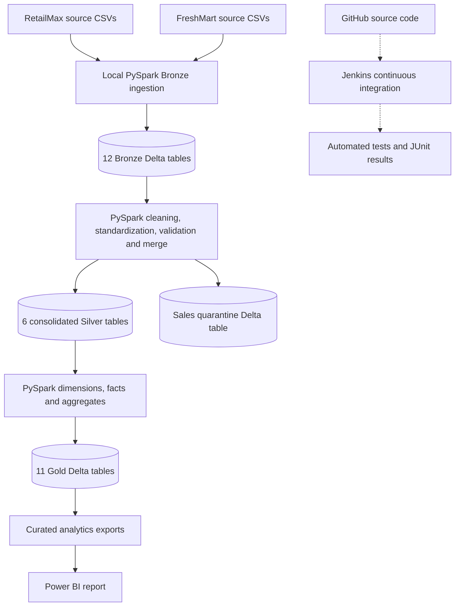
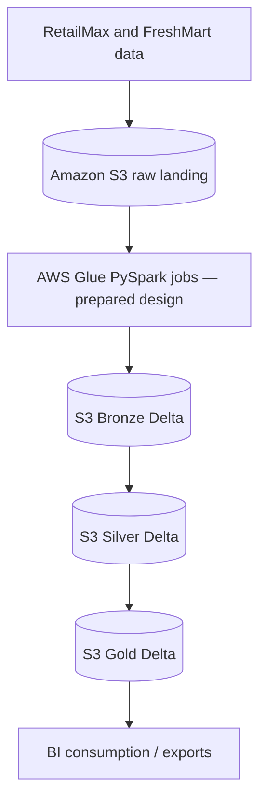

# Enterprise Retail Lakehouse Platform

### Post-Merger Data Consolidation — RetailMax Acquires FreshMart

**Stack:** Python · PySpark 3.5.6 · Delta Lake · Amazon S3 · AWS Glue-oriented ETL · Jenkins CI · GitHub · Power BI
**Domain:** Retail Data Engineering and Business Analytics
**Project type:** Portfolio case study using fictional companies and synthetic operational data
**Implementation status:** Complete and validated local Bronze → Silver → Gold execution; Power BI reporting and Jenkins CI completed. AWS Glue cloud execution not demonstrated.

## 1. Executive Summary

RetailMax acquires FreshMart, bringing together two organizations with separate customer, product, store, supplier, inventory, and sales data. Differences in source formats, duplicate records, missing values, and inconsistent identifiers make consolidated reporting difficult.

This project implements a **Medallion Architecture** that ingests both companies' operational data into Bronze Delta tables, standardizes and validates it in Silver, and builds analytical dimensions, facts, and aggregates in Gold. A completed Power BI report presents the curated results, while Jenkins CI tests the engineering codebase.

The full **local PySpark/Delta Lake pipeline** completed successfully in an isolated run (`local-full-001`). Validation verified **30 Delta tables**, reconciled **104,760 source rows** with Bronze, checked Silver business-key quality and sales referential integrity, and reconciled all six corresponding Silver and Gold business-key sets. The project includes AWS Glue-oriented components and S3-based development/testing artifacts; successful managed AWS Glue execution is **not** claimed.

### Business objectives

- Integrate operational datasets from RetailMax and FreshMart.
- Preserve raw source lineage and enable repeatable batch processing.
- Apply consistent cleaning, validation, standardization, and deduplication.
- Separate valid sales from records requiring investigation.
- Produce business-ready sales, product, store, and inventory datasets.
- Support cross-company analysis in Power BI.
- Demonstrate automated testing and safe, isolated pipeline execution.

## 2. Business Problem

Following an acquisition, leadership needs answers to questions such as:

1. What is the combined sales performance of both companies?
2. How do the companies and individual stores compare?
3. Which product categories contribute most to sales?
4. How does performance change over time?
5. Where are inventory shortages or other stock risks emerging?
6. Can analysts trace reported figures back to source data?

| Challenge | Lakehouse response |
|---|---|
| Separate operational systems | Consolidate six data domains across two companies |
| Inconsistent formats and identifiers | Canonical Silver transformations |
| Duplicate or invalid records | Business-key validation, deduplication, and quarantine |
| Limited traceability | Source and batch metadata in Bronze; Delta transaction logs |
| Repeated manual reporting work | Curated Gold dimensions, facts, and aggregates |

**Scope:** The companies and data are synthetic. The implementation demonstrates engineering behavior, not measured business improvements in a production enterprise.

## 3. Implemented Solution

The project processes **12 source CSV datasets** (six domains × two companies) through three layers:

- **Bronze:** Ingest source records into isolated Delta tables while retaining source/batch context.
- **Silver:** Standardize schemas, enforce data-quality rules, deduplicate business keys, and quarantine invalid sales.
- **Gold:** Build dimensions, facts, and aggregates for business analytics.

The pipeline runs locally using PySpark and Delta Lake. AWS Glue-compatible jobs, planning/orchestration modules, and deployment artifacts are also included, but the managed Glue job could not be created because of AWS account access restrictions.

## 4. Architecture

### Validated local execution



### AWS-oriented target architecture (not fully deployed)



**Execution boundary:** The first diagram describes the validated local run. The second illustrates the intended managed-cloud execution path; it must not be interpreted as a successfully executed AWS Glue production pipeline.

## 5. Business Data Domains

| Domain | RetailMax source rows | FreshMart source rows | Combined source rows |
|---|---:|---:|---:|
| Customers | 5,050 | 4,040 | 9,090 |
| Products | 1,000 | 800 | 1,800 |
| Stores | 50 | 40 | 90 |
| Suppliers | 100 | 80 | 180 |
| Inventory | 2,000 | 1,600 | 3,600 |
| Sales | 50,000 | 40,000 | 90,000 |
| **Total** | **58,200** | **46,560** | **104,760** |

Source records deliberately include data-quality issues to exercise transformation and validation logic.

## 6. Bronze Layer — Raw Ingestion

Bronze reads the 12 company/domain CSVs and writes a separate Delta table for each. The local runner uses deterministic source/batch identification and preserves ingestion context, including source system, dataset, file, batch ID, and ingestion timestamp.

**Verified outcome:** All **104,760** source rows were represented in Bronze, with exact row-count agreement for all 12 source datasets. Bronze is intended to preserve source data rather than perform business-level cleaning.

## 7. Silver Layer — Data Quality and Standardization

Silver consolidates the two companies into six canonical business tables. Processing includes schema mapping, required-field checks, normalization, deduplication, business-key handling, and sales foreign-key validation. Invalid sales are stored separately for investigation rather than silently included in analytics.

| Silver Delta table | Validated rows |
|---|---:|
| `customers` | 9,000 |
| `products` | 1,800 |
| `stores` | 90 |
| `suppliers` | 180 |
| `inventory` | 3,600 |
| `sales` | 88,600 |
| `sales_quarantine` | 1,400 |

**Sales reconciliation:** 88,600 valid + 1,400 quarantined = **90,000** source sales rows. The valid-sales share is approximately **98.44%**. Silver checks found **zero missing or duplicate business keys** and **zero missing ingestion timestamps** in the six canonical tables. Quarantined sales passed the tested status and transaction-key checks.

**Referential integrity:** All 88,600 valid sales referenced existing Silver customers, products, and stores; all three orphan-record counts were zero.

## 8. Gold Layer — Analytical Model

Gold provides curated dimensions, facts, and aggregate tables for reporting.

| Gold Delta table | Validated rows | Analytical role |
|---|---:|---|
| `dim_customers` | 9,000 | Customer dimension |
| `dim_suppliers` | 180 | Supplier dimension |
| `dim_products` | 1,800 | Product dimension |
| `dim_stores` | 90 | Store dimension |
| `dim_date` | 4,275 | Date dimension |
| `fact_sales` | 88,600 | Valid sales transactions |
| `fact_inventory` | 3,600 | Inventory facts |
| `agg_daily_sales` | 2,736 | Daily sales summaries |
| `agg_store_performance` | 90 | Store performance summaries |
| `agg_category_sales` | 14 | Product category summaries |
| `agg_inventory_status` | 59 | Inventory status summaries |

All 11 Gold tables were readable and nonempty. Defined business-key checks for the six corresponding dimensions/facts found no null or duplicate keys. All six Silver-to-Gold reconciliations had **matching row counts, zero missing business keys, and zero extra business keys**.

These validations do not independently establish the correctness of every aggregate calculation or business metric.

## 9. End-to-End Data Flow Example

For a FreshMart sales record:

1. The source CSV is read by the local Bronze ingestion stage.
2. The record is written to a FreshMart Bronze Delta table with ingestion metadata.
3. Silver applies canonical mapping and quality checks.
4. A valid transaction is merged into Silver `sales`; an invalid one can be directed to `sales_quarantine`.
5. Gold `fact_sales` and relevant analytical aggregates are refreshed from curated Silver data.
6. Gold analytical outputs support the completed Power BI report.

This describes the **executed local processing flow**. The AWS Glue/S3 equivalent remains a cloud deployment design, not a verified managed execution.

## 10. Incremental Processing and Batch Identification

The project includes source-object validation, deterministic batch identification, and incremental-processing components. Source identity and version context support traceability and help distinguish one input batch from another.

The repository also contains orchestration/planning controls. **The existing master orchestrator is planning-only** and does not enable full cloud execution. The dedicated local runner is the explicitly enabled path used for the isolated full run.

These features provide an engineering foundation for controlled reprocessing; they should not be confused with a claim that all production scheduling, recovery, or idempotency scenarios have been verified in a managed environment.

## 11. AWS Glue and Amazon S3

The repository includes AWS Glue-oriented Python entry points, runtime argument and configuration validation, Bronze/Silver/Gold processing modules, deployment packaging, and a prepared AWS Glue 5.0-oriented configuration.

Amazon S3 has been used for isolated development/testing artifacts. The project deliberately protects earlier completed test prefixes and does not require new AWS writes to reproduce the validated local run.

**Cloud execution limitation:** AWS account permissions prevented creation of the Glue job. Consequently, a successful end-to-end AWS Glue cloud run is **not** claimed. The Glue entry point and master orchestration controls retain planning/dry-run safety restrictions.

## 12. Delta Lake

Delta Lake supplies transactional table storage and `_delta_log` metadata for the lakehouse layers. Relevant capabilities include:

- ACID transaction support for table operations.
- Schema enforcement and controlled schema evolution.
- Transaction logs and table-version history.
- MERGE-based update patterns in Silver processing.
- Time travel where retained versions are available.

The local run confirmed that all **30 expected Delta table directories** contain Delta transaction logs. This is evidence of successful table creation, not a standalone test of every Delta Lake feature.

## 13. Data Quality and End-to-End Validation

The isolated run `local-full-001` completed Bronze → Silver → Gold successfully. Subsequent read-only checks produced the following results:

| Check | Observed result |
|---|---|
| Delta table completeness | 12 Bronze + 7 Silver + 11 Gold = **30/30** |
| Source-to-Bronze row reconciliation | **104,760 / 104,760**; all 12 datasets matched |
| Silver missing business keys | **0** |
| Silver duplicate business keys | **0** |
| Silver missing ingestion timestamps | **0** |
| Valid Silver sales | **88,600** |
| Quarantined sales | **1,400**, with validated status and unique transaction keys |
| Valid-sales customer/product/store references | **0** orphans in each relationship |
| Gold table completeness | **11/11** readable and nonempty |
| Gold defined key checks | **0** null or duplicate keys |
| Silver-to-Gold business-key reconciliation | **6/6** matched, **0** missing and **0** extra |

**Validation scope:** These checks establish the tested record counts, keys, and relationships. They do not constitute exhaustive testing of every analytical aggregate, security control, production recovery scenario, or AWS Glue deployment.

## 14. Technology Stack

| Technology | Use |
|---|---|
| Python | Pipeline and test implementation |
| PySpark 3.5.6 | Local distributed-style data transformations |
| Delta Lake 3.3.2 | Bronze, Silver, and Gold Delta tables |
| Amazon S3 | Cloud storage for isolated development/testing artifacts and target lakehouse design |
| AWS Glue | Cloud-oriented ETL modules and deployment preparation; execution blocked by permissions |
| Jenkins | **Implemented continuous integration** |
| GitHub | Source control and portfolio repository |
| Power BI | **Completed analytical report** |
| WSL Ubuntu 22.04 | Local development and execution environment |

## 15. Power BI Reporting

A Power BI report has been completed using curated analytical outputs. The project includes Gold analytical CSV exports for reporting and a Power BI report artifact (`Retail_Lakehouse_Analytics_Incremental.pbix`).

The reporting experience supports business analysis across the combined retail operation, including KPI summaries, company-level comparisons, trends, and operational performance. The previously documented dashboard design includes four KPI indicators, eight analytical charts, and company/date filtering.

The report is an analytical demonstration, not a claim of production Power BI service deployment or automated cloud refresh.

## 16. Development, Testing, and CI

Development uses WSL Ubuntu, a Python virtual environment, PySpark, Delta Lake, and GitHub. Jenkins CI is **implemented**, not merely planned.

- Jenkins job: `retail-lakehouse-ci`.
- Latest confirmed successful CI run: **Build #6**.
- **506 automated tests passed** in that run.
- JUnit test results were archived.
- The CI workflow exercises code/testing and safe planning behavior; it is **not** an automated production deployment workflow.

The full local ETL run and its subsequent read-only reconciliation checks were executed separately from the Jenkins test suite.

## 17. Project Status

| Component | Status |
|---|---|
| Repository, WSL, Python, Spark, Delta environment | Completed |
| Bronze ingestion | Completed and validated locally |
| Silver transformations, deduplication, quarantine | Completed and validated locally |
| Gold dimensions, facts, aggregates | Completed and validated locally |
| Local Bronze → Silver → Gold orchestration | **Completed successfully** (`local-full-001`) |
| Delta table outputs | **30/30 verified** |
| End-to-end reconciliation and quality checks | **Passed within tested scope** |
| Power BI report | **Completed** |
| Jenkins CI | **Completed; 506 tests passed** |
| AWS Glue-oriented modules and deployment package | Prepared and locally tested |
| Managed AWS Glue job execution | **Not completed — account access restriction** |
| Jenkins continuous deployment | Not in scope |
| Natural-language analytics agent | Not in scope |

## 18. Local Execution and Reproducibility

The validated run used the dedicated local runner:

```bash
python3 -m src.pipeline.run_local_pipeline \
  --run-id local-full-001 \
  --execute-local
```

This command is included as a **historical record of the completed run**, **not** as an instruction to rerun it. The runner requires a **new, unused `local-...` run ID** and refuses to reuse an existing target. It writes under `local_runs/<run-id>/` and must not overwrite `local-full-001` or other prior outputs.

For a planning-only inspection with an unused run ID, consult the runner's `--help` and use its `--dry-run` mode. Do not enable writes to AWS or change the master orchestrator's safety controls merely to reproduce the local demonstration.

Local datasets, Delta output directories, and Power BI binaries may be excluded from GitHub because of size or repository hygiene; the repository should not be assumed to contain every generated run artifact.

## 19. Outcomes, Boundaries, and Next Steps

### Demonstrated engineering outcomes

- Unified two synthetic retailers' source domains through a common Medallion pipeline.
- Preserved 104,760 source rows in Bronze and reconciled them to source CSV counts.
- Segregated 1,400 sales records into quarantine while retaining 88,600 valid sales.
- Produced 11 Gold analytical tables and a completed Power BI report.
- Verified tested key integrity and record reconciliation between layers.
- Implemented Jenkins CI with 506 passing tests.

### Explicit boundaries

- No claim of production deployment, production-scale performance, or measured business ROI.
- No claim of successful managed AWS Glue execution.
- No Jenkins CD or natural-language analytics agent is part of the project scope.
- Aggregate-measure correctness and production operations would require additional testing before real-world use.

The remaining portfolio work is documentation and presentation, including any screenshots or diagrams the repository owner chooses to publish. A GitHub push should be performed only after review and explicit approval.

## 20. Conclusion

The **Enterprise Retail Lakehouse Platform** demonstrates a completed, locally executed and validated retail data-engineering workflow for post-merger consolidation. It integrates 12 source datasets into 30 Bronze/Silver/Gold Delta tables, enforces tested data-quality and referential-integrity rules, creates curated analytical outputs, and supports a completed Power BI report. Jenkins CI adds automated test coverage and a repeatable engineering workflow.

The project also illustrates an important real-world distinction: **a locally validated data pipeline and a prepared cloud deployment are not the same as successful managed-cloud execution**. The README reports each separately so the implementation can be discussed accurately in interviews.

---

**Repository:** [Enterprise Retail Lakehouse Platform](https://github.com/pardhasai5423-cloud/retail-lakehouse-platform)
