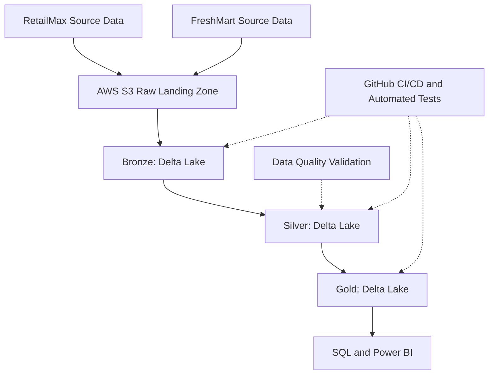

# Enterprise Retail Lakehouse Architecture

## Business Scenario

RetailMax and FreshMart have merged. Their source systems use
different schemas, identifiers, and date formats.

The goal is to consolidate both companies' data into a
unified analytics platform.

## Target Architecture

## Architecture Layers

### Source Systems
- RetailMax: six CSV datasets
- FreshMart: six CSV datasets
- Different schemas, IDs, and date formats

### Raw Landing Zone
- Planned AWS S3 storage
- Preserve original source files
- Organize by company and dataset

### Bronze Layer
- Ingest raw source records using PySpark
- Write Delta Lake tables
- Preserve source columns and values
- Add ingestion timestamps and source metadata

### Silver Layer
- Standardize schemas across companies
- Validate required fields and relationships
- Handle duplicates and invalid values
- Identify overlapping customer identities

### Gold Layer
- Unified sales reporting
- Revenue by store and category
- Customer analytics
- Inventory and stock reporting

### Consumption
- SQL queries
- Power BI dashboards

## Implementation Strategy

Phase 1: Local development using Ubuntu WSL, PySpark,
and Delta Lake.

Phase 2: AWS S3 integration and cloud ingestion.

Phase 3: Automated testing, CI/CD, and reporting.
