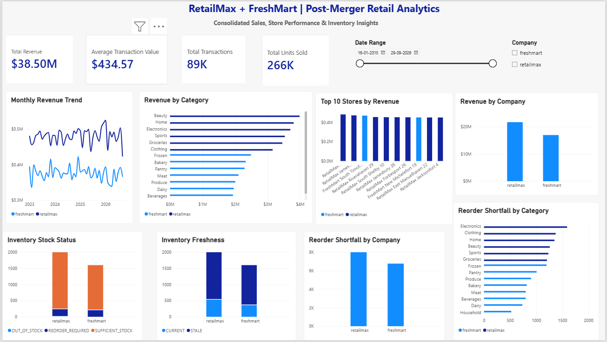

# RetailMax + FreshMart | Post-Merger Retail Analytics

## Overview

This Power BI dashboard provides a consolidated view of sales performance, store performance, and inventory health following the fictional acquisition of FreshMart by RetailMax.

The dashboard is the business intelligence layer of the Enterprise Retail Lakehouse Platform.

## Data Architecture

The dashboard consumes curated Gold-layer datasets produced by the PySpark and Delta Lake pipelines.

Data flow:

Synthetic Source Data → Amazon S3 Raw → Bronze Delta → Silver Delta → Gold Delta → Power BI

### Gold Tables

**Dimensions**
- dim_customers
- dim_products
- dim_suppliers
- dim_stores
- dim_date

**Facts**
- fact_sales
- fact_inventory

**Aggregations**
- agg_daily_sales
- agg_store_performance
- agg_category_sales
- agg_inventory_status

A calculated `dim_company` table is also used in Power BI to filter RetailMax and FreshMart consistently.

## Dashboard KPIs

| KPI | Full Dataset Value |
|---|---:|
| Total Revenue | $38,502,722.50 |
| Average Transaction Value | $434.57 |
| Total Transactions | 88,600 |
| Total Units Sold | 265,533 |

Dashboard cards display rounded values.

## Dashboard Visualizations

### Sales and Revenue
1. Monthly Revenue Trend
2. Revenue by Category
3. Top 10 Stores by Revenue
4. Revenue by Company

### Inventory Management
5. Inventory Stock Status
6. Inventory Freshness
7. Reorder Shortfall by Company
8. Reorder Shortfall by Category

## Interactive Filters

### Company Slicer

Filters the dashboard between:
- RetailMax
- FreshMart

The company dimension uses `source_system` to preserve the identity of each company's data.

### Date Range Slicer

Allows users to select a date range for sales analysis.

The slicer filters sales metrics and related sales visualizations through the date dimension.

Inventory status aggregations represent the current inventory snapshot and are not historical inventory trends.

## Data Modeling

Power BI uses a dimensional model with one-to-many relationships between dimensions and fact or aggregation tables.

Relationships use single-direction filtering where appropriate.

Company filtering is implemented through the calculated `dim_company` table.

## Data Quality and Business Rules

- Source-qualified identifiers prevent cross-company key collisions.
- Invalid sales transactions are quarantined before Gold processing.
- Customer identities are not automatically merged across companies.
- Product categories are retained as provided by each company.
- Inventory freshness is classified as CURRENT or STALE.
- Inventory stock status is classified as OUT_OF_STOCK, REORDER_REQUIRED, or SUFFICIENT_STOCK.
- Reorder shortfall measures additional units required to meet reorder thresholds.
- Missing product prices are preserved rather than silently replaced with zero.

## Dashboard Validation

The dashboard was checked against independently validated Gold-layer results.

Company filtering was tested separately for RetailMax and FreshMart.

Date filtering was tested using January 2025 through September 2026, confirming that sales KPIs and monthly revenue trends respond to the selected period.

## Business Value

The dashboard helps stakeholders:

- Compare the performance of both companies.
- Identify revenue-generating product categories.
- Evaluate top-performing stores.
- Monitor inventory shortages.
- Identify stale inventory records.
- Prioritize inventory replenishment.
- Analyze sales performance over selected time periods.

## Implementation Notes

The Power BI report was developed in Power BI Desktop using curated Gold-layer data.

The project uses synthetic data and represents a fictional retail merger.

This dashboard is intended as a portfolio demonstration of data engineering, dimensional modeling, and business intelligence capabilities.

## Dashboard Preview

The following screenshot shows the completed Power BI dashboard with consolidated sales, store performance, and inventory analytics.

